# How well can a computer read our fake Hindi deeds?

*Reader tested: Tesseract. 265 pages scored. Page file made 2026-10-27.*

| Clean printed copy | Easy damaged pages | Medium damaged pages | Hard damaged pages |
|---|---|---|---|
| **0.6** | **14** | **25** | **58** |
| letters wrong or missed out of 100. 84% of key facts found. | letters wrong or missed out of 100. 62% of key facts found. | letters wrong or missed out of 100. 44% of key facts found. | letters wrong or missed out of 100. 18% of key facts found. |

We made fake Hindi sale deeds where we know every name, date and amount. We damaged them step by step, then asked a free reading program to read each page and checked its answer against what we know is written.

## What stands out

- **The harder the page, the more the reader misses.** Out of 100 letters it gets wrong or loses 14 on easy pages, 25 on medium and 58 on hard.
- **Damage is a big part of it.** The same hard pages without any damage lose 18 out of 100, so the damage adds about 41.
- **Handwriting-style text is harder than printed text.** 56 out of 100 lost on handwriting-style pages, against 34 on printed ones.
- **Our hardest handwriting set is close to unreadable for this reader.** It finds 2.2% of the key facts and 100% of the pages count as failed.
- **Numbers are the weak spot.** Even on the clean printed copy only 52% of numbers are read exactly, against 84% for all facts, because single digits slip.
- **Part of the error is not the reader's fault.** On printed pages, 12 of every 24 counted errors are extra text (stamps, notes and header art the reader sees but our answer does not list).

## What we did, and why

**1. Write fake deeds.** We decide every name, date, place and amount first, then write the deed text from them.  
*Why: So we always know the right answer for every page.*

**2. Draw the pages.** Each deed is drawn like a real page: fonts, headers, stamps, signatures, thumbprints, margin notes, some handwriting-style text.  
*Why: Real deeds are messy, and a reader trained or tested on neat pages will not cope with them.*

**3. Damage them in 5 steps.** Folds, tears, blur, ink marks, scan noise, increasing from stage 1 to stage 5. From light to severe: 1 scan wear, 2 paper ageing, 3 ink damage, 4 geometry and physical, 5 severe.  
*Why: We want to know at which point a reader breaks, so the damage grows in steps.*

**4. Label each page easy, medium or hard.** A score from how much of the text is covered, how faint it is, and how much is handwriting or small print.  
*Why: So we can say how bad a page is without running a reader. The label is a first version and still needs checking against real pages.*

**5. Make a clean printed copy as a control.** The same text in a plain printed font on a white page, nothing damaged.  
*Why: It shows how good the reader is when the page is fine. Any drop on our pages is then due to the pages, not the reader.*

**6. Let the reader read every page.** Tesseract reads each page and we compare its text with the answer, letter by letter and fact by fact.  
*Why: The same cleaning and the same rules apply to every reader, so results can be compared.*

**7. Group the results.** By how hard the page is, damage stage and kind of text. Also a clean copy of each page, to separate damage from everything else.  
*Why: To see what makes pages hard, not only how hard they are.*

## What the pages look like

The same page, from clean to severe damage.

| 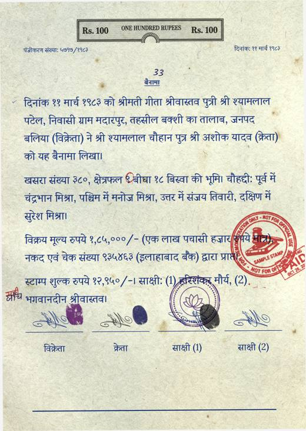 | 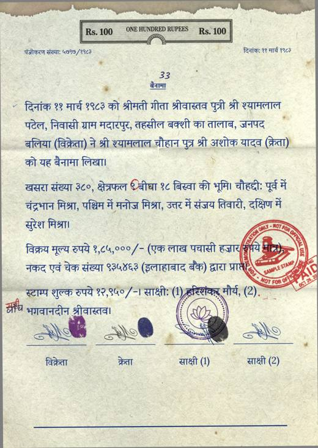 | 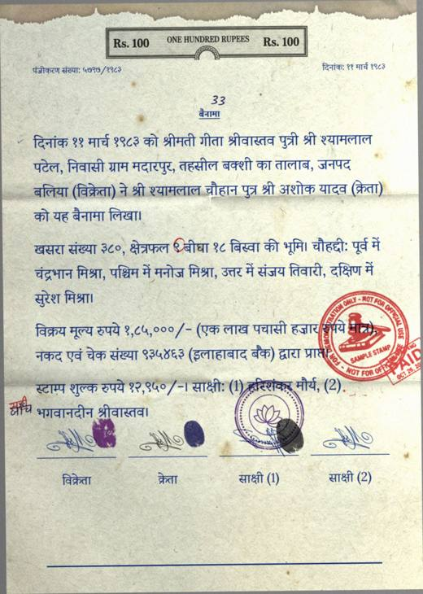 |
|---|---|---|
| Before any damage (clean copy) | Stage 1: scan wear | Stage 2: paper ageing |

| 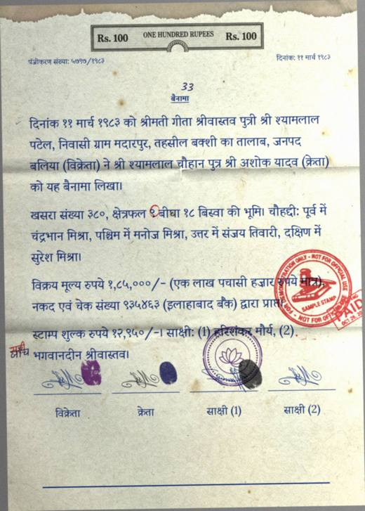 | 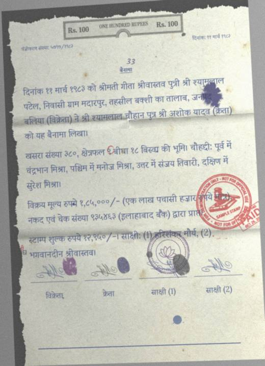 | 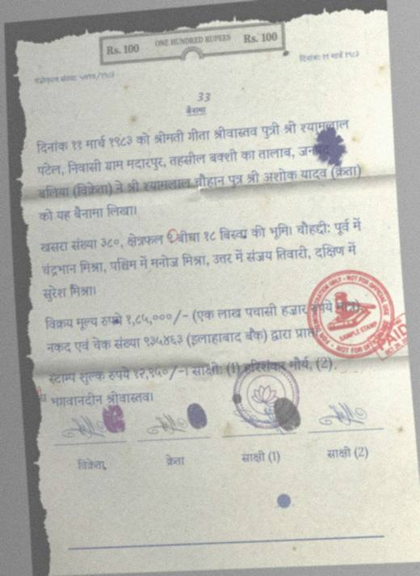 |
|---|---|---|
| Stage 3: ink damage | Stage 4: geometry and physical | Stage 5: severe |

Other kinds of page we test on.

| 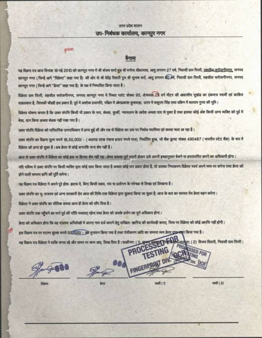 | 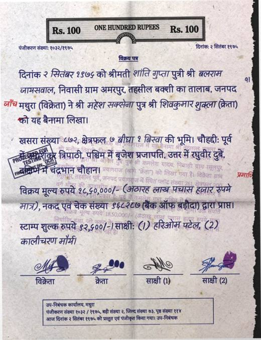 | 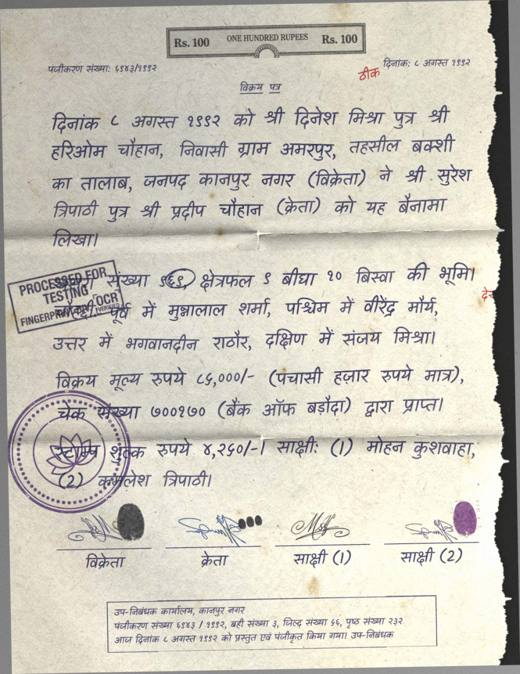 |
|---|---|---|
| Printed text, damage stage 3 (ink damage), rated medium | Printed with handwritten parts, damage stage 3 (ink damage), rated medium | Handwriting-style text, damage stage 3 (ink damage), rated hard |

| 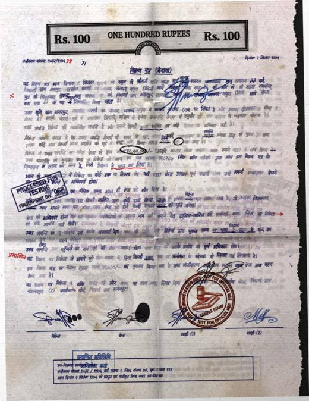 |
|---|
| Hard handwriting set: Handwriting-style text, damage stage 4 (geometry and physical), rated hard |

## Results

- **Wrong or missed letters**: letters in the answer that the reader got wrong or left out, per 100 letters of the answer. Lower is better.
- **Extra letters**: text the reader wrote that is not in the answer. On our pages it is mostly stamps and notes.
- **Key facts found**: names, places, dates and amounts from the answer that appear exactly in the reader's text.
- **Failed page**: more than half of the letters wrong.

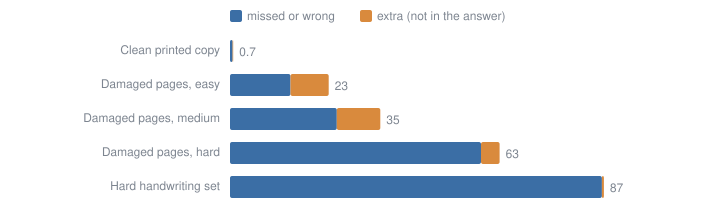

*Each bar is the number of letters out of 100 that the reader got wrong, lost, or added.*

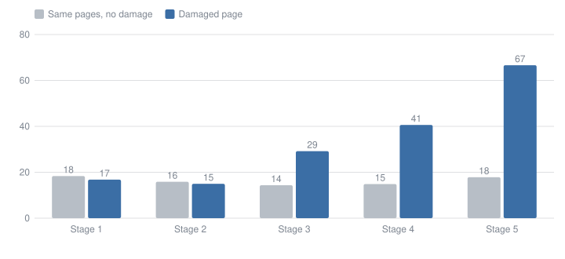

*More damage means more missed letters. The grey bars show the same pages without damage, so the gap is what damage costs.*

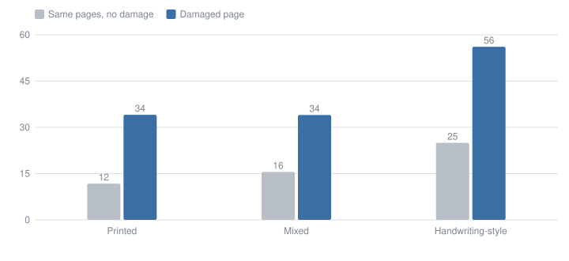

*Printed text is easiest. Handwriting-style text is hardest, even before damage.*

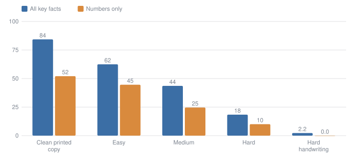

*This is what matters for a deed: who sold what to whom, and for how much. Numbers are the hardest part.*

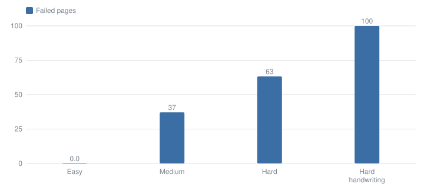

*A page fails when more than half of its letters are wrong.*

All the numbers

| Group | Pages | Letters missed per 100 | Extra per 100 | Key facts found | Numbers found | Failed pages |
|---|---|---|---|---|---|---|
| Damaged, set A, difficulty easy | 16 | 14 | 8.9 | 62% | 45% | 0.0% |
| Damaged, set A, difficulty hard | 49 | 58 | 4.3 | 18% | 10% | 63% |
| Damaged, set A, difficulty medium | 35 | 25 | 10 | 44% | 25% | 37% |
| Damaged, set B, difficulty hard | 40 | 86 | 0.5 | 2.2% | 0.0% | 100% |
| Damaged, set C, difficulty easy | 6 | 6.9 | 16 | 66% | 48% | 33% |
| Damaged, set C, difficulty hard | 11 | 64 | 12 | 17% | 11% | 82% |
| Damaged, set C, difficulty medium | 8 | 31 | 15 | 43% | 36% | 50% |
| Damaged, set P, difficulty control | 100 | 0.6 | 0.1 | 84% | 52% | 0.0% |
| Damaged, set A, style handwritten | 28 | 56 | 7.4 | 17% | 11% | 68% |
| Damaged, set A, style hybrid | 31 | 34 | 8.3 | 29% | 13% | 35% |
| Damaged, set A, style printed | 41 | 34 | 6.3 | 50% | 33% | 34% |
| Damaged, set B, style handwritten | 40 | 86 | 0.5 | 2.2% | 0.0% | 100% |
| Damaged, set C, style handwritten | 10 | 57 | 15 | 13% | 3.6% | 80% |
| Damaged, set C, style hybrid | 5 | 24 | 39 | 41% | 30% | 100% |
| Damaged, set C, style printed | 10 | 22 | 8.5 | 60% | 51% | 20% |
| Damaged, set P, style printed | 100 | 0.6 | 0.1 | 84% | 52% | 0.0% |
| Damaged, set A, stage 1 | 8 | 17 | 12 | 44% | 29% | 25% |
| Damaged, set A, stage 2 | 11 | 15 | 14 | 50% | 33% | 27% |
| Damaged, set A, stage 3 | 29 | 29 | 9.4 | 44% | 28% | 31% |
| Damaged, set A, stage 4 | 31 | 41 | 5.6 | 29% | 15% | 48% |
| Damaged, set A, stage 5 | 21 | 67 | 1.8 | 16% | 9.4% | 71% |
| Damaged, set B, stage 4 | 20 | 78 | 0.9 | 4.2% | 0.0% | 100% |
| Damaged, set B, stage 5 | 20 | 95 | 0.0 | 0.2% | 0.0% | 100% |
| Damaged, set C, stage 1 | 5 | 15 | 19 | 48% | 32% | 40% |
| Damaged, set C, stage 2 | 5 | 11 | 18 | 49% | 36% | 40% |
| Damaged, set C, stage 3 | 5 | 35 | 13 | 42% | 36% | 60% |
| Damaged, set C, stage 4 | 5 | 57 | 12 | 28% | 21% | 80% |
| Damaged, set C, stage 5 | 5 | 58 | 8.5 | 19% | 14% | 80% |
| Damaged, set P, stage 0 | 100 | 0.6 | 0.1 | 84% | 52% | 0.0% |
| Clean copy, set A, difficulty easy | 16 | 11 | 8.8 | 63% | 41% | 0.0% |
| Clean copy, set A, difficulty hard | 49 | 18 | 16 | 42% | 25% | 33% |
| Clean copy, set A, difficulty medium | 35 | 16 | 13 | 49% | 30% | 37% |
| Clean copy, set B, difficulty hard | 40 | 50 | 6.2 | 15% | 9.1% | 70% |
| Clean copy, set C, difficulty easy | 6 | 9.6 | 12 | 64% | 52% | 33% |
| Clean copy, set C, difficulty hard | 11 | 25 | 20 | 34% | 21% | 45% |
| Clean copy, set C, difficulty medium | 8 | 12 | 18 | 53% | 40% | 38% |
| Clean copy, set A, style handwritten | 28 | 25 | 17 | 24% | 15% | 46% |
| Clean copy, set A, style hybrid | 31 | 16 | 14 | 39% | 16% | 29% |
| Clean copy, set A, style printed | 41 | 12 | 12 | 71% | 49% | 17% |
| Clean copy, set B, style handwritten | 40 | 50 | 6.2 | 15% | 9.1% | 70% |
| Clean copy, set C, style handwritten | 10 | 24 | 23 | 24% | 13% | 50% |
| Clean copy, set C, style hybrid | 5 | 24 | 45 | 38% | 27% | 100% |
| Clean copy, set C, style printed | 10 | 8.4 | 6.6 | 76% | 60% | 0.0% |
| Clean copy, set A, stage 1 | 8 | 18 | 15 | 41% | 20% | 25% |
| Clean copy, set A, stage 2 | 11 | 16 | 13 | 48% | 30% | 36% |
| Clean copy, set A, stage 3 | 29 | 14 | 14 | 53% | 31% | 28% |
| Clean copy, set A, stage 4 | 31 | 15 | 15 | 47% | 29% | 32% |
| Clean copy, set A, stage 5 | 21 | 18 | 13 | 46% | 30% | 24% |
| Clean copy, set B, stage 4 | 20 | 45 | 5.9 | 18% | 10% | 60% |
| Clean copy, set B, stage 5 | 20 | 55 | 6.5 | 13% | 7.8% | 80% |
| Clean copy, set C, stage 1 | 5 | 13 | 19 | 46% | 36% | 40% |
| Clean copy, set C, stage 2 | 5 | 15 | 17 | 47% | 39% | 40% |
| Clean copy, set C, stage 3 | 5 | 14 | 17 | 49% | 32% | 40% |
| Clean copy, set C, stage 4 | 5 | 15 | 16 | 48% | 32% | 40% |
| Clean copy, set C, stage 5 | 5 | 20 | 14 | 46% | 32% | 40% |

## Why Tesseract as the first reader

- It is free, runs on a normal laptop, and has a Hindi language file, so anyone on the team can repeat the test.
- It is the usual starting point for OCR, so the numbers mean something to other people.
- It reads text only, with no AI guessing missing words, so its mistakes show what the page itself does to a reader.
- It is a starting point, not the best reader. A second reader and an AI model that reads whole pages are set up in the code but not run yet.

## Two papers behind this

- [Augraphy: A Data Augmentation Library for Document Images](https://arxiv.org/abs/2208.14558), Groleau and colleagues, ICDAR 2023. Why we read it: it shows how to make a clean page look like a real scan (blur, folds, ink marks, noise) in a repeatable way. We use its library for some of our damage effects, so our damage is not made up from scratch.
- [An Overview of the Tesseract OCR Engine](https://research.google/pubs/an-overview-of-the-tesseract-ocr-engine/), Ray Smith, ICDAR 2007. Why we read it: it explains how our first reader works, and why it is a fair starting point. The paper describes the original design. Newer versions added a neural-network reader, which is the kind we run with the Hindi language file.

## Things to keep in mind

- Only one reader so far.
- Some groups are small (for example 5 pages per damage stage in the ladder set), so small differences mean little.
- The easy, medium and hard label also reflects handwriting and small print, not only damage.
- The pages are made by us. We still need to check how they compare with real scanned deeds.

## What comes next

- Run the second reader and the AI page reader on the same pages and add them here.
- Read a few real scanned deeds and place them on the same easy, medium, hard scale.
- Use what we learn to tune the damage, then restart the handwriting step.

---
*How scores are worked out: docs/SCORING.md. Raw numbers: docs/results/. This page was made by python -m benchmark.dashboard.*
